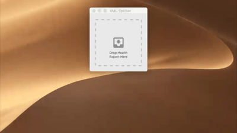

# Health XML Splitter

Health XML Splitter splits large health exports generated by Health.app into smaller, individual chunks.



This app was built specifically for use with [Health Data Importer](https://lionheartsw.com/software/health-importer), the iOS app that you can use to import your Health data when migrating to a new device.

## Compatibility

The current source requires macOS 13 and later. Older published versions support earlier macOS releases.

## Installation

You can download Health XML Splitter directly from the [macOS App Store](https://itunes.apple.com/us/app/health-xml-splitter/id1437100857?ls=1&mt=12) or through [direct download](https://github.com/lionheart/Health-XML-Splitter/releases/download/v1.0.1/Health.XML.Splitter.1.0.1.app.zip).


## Usage

* Drag and drop your `export.xml` or `export.zip` file right into the main window.
* Create a directory to save the generated chunks into.
* Let the app run until it's done processing the export. This may take a few minutes.
* Open the generated chunks using Health Data Importer on your iPhone.

## Support

If you encounter a problem, please [open an issue](https://github.com/lionheart/Health-XML-Splitter/issues/new).

## Development

The current source targets macOS 13 and later, matching the [minimum supported
version for Go 1.27](https://go.dev/doc/go1.27#darwin). Building requires Xcode and
Go 1.27.1 or later. Open `XML Splitter.xcodeproj` and build the **Health XML
Splitter** scheme. Its build phase generates a static `HealthSplitter.xcframework`
with a universal macOS slice containing both Apple Silicon and Intel code.
The app and CLI import its generated `HealthSplitter` module; the framework is
linked statically and does not need to be embedded. End users do not need Go.

The project navigator's **Go** group contains the engine and bindings, their Go
tests, `go.mod`, `go.sum`, the Makefile, build scripts, and Swift integration test.
The Go files are editable project references. Both Xcode targets run the **Build
Go engine** phase before compiling Swift, so normal Build/Run actions pick up Go
edits and regenerate the framework without a separate terminal build. The script
uses Go's build cache and also runs when new Go files are added to the module.

The build compiles gomobile and gobind from the same version pinned by the
`go.mod` tool directives and verified by `go.sum`. A first build needs network
access to download the pinned tools and dependencies. No global gomobile
installation or `gomobile init` is required. Set `GO_BINARY` to an absolute Go
executable path if Go is not on Xcode's PATH; Homebrew's standard paths are also
searched.

The first stage of the cross-platform migration keeps the AppKit interface and
moves XML sanitization, parsing, chunk boundaries, and XML output into Go:

```text
AppKit → Parser.swift → generated Objective-C bindings → Go binding adapter → Go engine
```

- `internal/splitter` contains the portable engine, with XML parsing in `split.go`,
  chunk-file ownership and cleanup in `chunks.go`, and stream sanitization in
  `sanitize.go`. It has no UI or gomobile dependency.
- `bindings/healthsplitter` exposes a small gomobile-compatible engine object and
  progress interface using strings and signed integers. The adapter forwards
  progress at most every 50 ms between chunk boundaries, keeping large exports
  from flooding the native UI with per-record updates.
- `XML Splitter/Parser.swift` imports the generated module and preserves the
  existing `ParserDelegate` interface. It implements the generated progress
  protocol and calls the engine's throwing method using Swift `try`/`catch`.

Calls are synchronous, so the Mac controller continues to use its background
queue. Progress is delivered on that worker thread; the existing controller
marshals UI updates to the main queue. The adapter does not store the listener
after the call, avoiding a persistent cross-language reference cycle. Generated
bindings handle object lifetimes, strings, and Go errors (`NSError` in Objective-C and
thrown errors in Swift), replacing the handwritten C header, callbacks, and
allocation/free functions. The Go engine supports context cancellation; exposing
it through the bindings is a future step. Other native platforms can wrap the
same engine with their own bindings.

The engine streams output instead of retaining an entire chunk in memory. It
preserves the existing threshold rule: count all closed elements, then split
after exceeding the threshold at a complete top-level record. Each chunk retains
the root attributes, and subsequent chunks repeat `ExportDate`. XML formatting
may differ from the old writer. Known invalid ASCII control characters are
removed; structurally malformed XML returns an error to the caller.
Existing output files are never overwritten. On failure, the unfinished chunk
is removed and completed chunks remain; any cleanup failure is included in the
returned error.

ZIP extraction, output compression, destination selection, and opening Finder
remain in the Mac layer for this increment. Moving the ZIP pipeline into the Go
engine is the next step toward supporting other native platform interfaces.

The Makefile defaults to building the XCFramework and has focused build, test,
vet, and formatting targets. Override `GO` to select a particular Go executable.
Run the engine tests and the Swift/gomobile/Go integration test with:

```sh
make test vet
```

Build the XCFramework separately with `make go-library`. The generated framework
and local tool executables are placed under the ignored `build/HealthSplitter`
directory. Xcode builds use a separate directory per target and configuration.
GitHub Actions runs Go race tests and vet on Linux, and builds the universal
framework, exercises the Swift integration, and builds the app and CLI through
Xcode on macOS.
